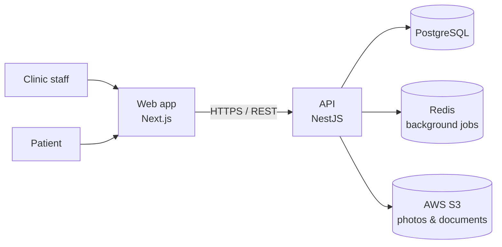

# NIIVVA — Clinic Management ERP for Aesthetic Clinics

> A multi-tenant SaaS that runs the full operational cycle of an aesthetic clinic — from the first appointment to the final receipt.

## The problem

Most aesthetic clinics run on a patchwork of tools: one app for scheduling, paper or spreadsheets for clinical records, quotes sent over WhatsApp, and a separate tool (or a notebook) for finances. The result is:

- **Fragmented client history** — treatments, photos, payments and conversations live in different places.
- **Lost revenue** — quotes go cold because nobody follows up.
- **Little financial visibility** — it's hard to know what was received, what's pending and what's overdue.
- **Guesswork pricing** — procedures are priced by intuition, not by the real cost of an hour of clinic time.

## The solution

NIIVVA connects every step of the clinic's day in one continuous flow:

```
Schedule → Treat & record → Quote → Sell → Bill → Receive → Issue receipt
                              ↘ Commercial follow-up
                              ↘ Cost-based pricing → Reports
```

Each step feeds the next — an approved quote becomes a sale, a sale becomes installments, a payment becomes a receipt — so the team never re-types data and nothing falls through the cracks.

## Modules

| Module | What it does |
|---|---|
| **Scheduling** | Day and week views per professional, status tracking from booked to completed, conflict prevention, package session booking |
| **Client 360** | A single page per client with clinical history, photos, quotes, payments, sessions, appointments, receipts and alerts, plus a unified timeline |
| **Clinical records** | Treatment notes, before/after photos and configurable health questionnaires |
| **Online questionnaire** | Shareable link where the patient fills in their health history and signs digitally before the visit |
| **Quotes** | Procedures, packages and products with discounts; a send → approve → convert flow; loss reasons; an interactive **face map** that builds the treatment plan |
| **Sales & finance** | One-click conversion from quote, installment billing, accounts receivable dashboard, partial payments, write-offs and numbered receipts |
| **Commercial follow-up (CRM)** | Deal pipeline, activities and automated follow-up sequences so no quote is forgotten |
| **Pricing** | Calculates the clinic's real hourly cost and suggests procedure prices with taxes, fees and margin |
| **Reports** | Overview, quotes, sales, procedures, appointments and pricing comparison |

## What sets it apart

- **True multi-tenancy** — each clinic's data is strictly isolated, enforced at the data-access layer rather than left to each screen.
- **Client 360** — everything about a client in one place, instead of scattered across tabs and tools.
- **Quote-to-cash in one flow** — the commercial and financial sides share the same records, so revenue and receivables are always consistent.
- **Cost-based pricing** — prices grounded in the clinic's actual hourly cost, not guesswork.
- **Built for health data** — role-based access for five clinic roles, an append-only audit trail for sensitive operations, and soft deletion so clinical evidence is never silently destroyed (LGPD-minded).
- **Concurrency-safe finances** — payments, sequential document numbers and package balances are protected against race conditions.
- **Own design system** — a consistent, accessible UI built from a custom component library.

## Tech stack

**Front-end:** React, Next.js (App Router), TypeScript, Tailwind CSS, TanStack Query, React Hook Form, Zod
**Back-end:** Node.js, NestJS, TypeScript, Prisma, Zod
**Data & infra:** PostgreSQL, Redis + BullMQ (background jobs), AWS S3 (file storage), Docker
**Tooling:** Turborepo monorepo, pnpm, Jest, ESLint, Prettier

## Architecture



## Screenshots

| | |
|---|---|
|  |  |
| *Scheduling* | *Client 360* |
|  |  |
| *Quote with face map* | *Accounts receivable* |
|  |  |
| *Commercial follow-up* | *Cost-based pricing* |

---

Source code is private. Demo available upon request. © 2026 Geovane A. L. Silva. All rights reserved.
